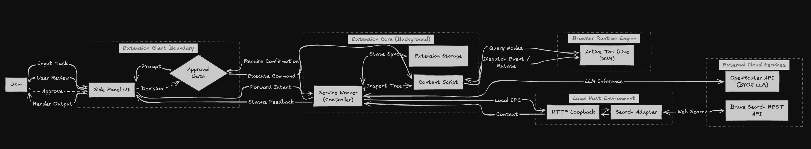

<h1 align="center"><code>Atlas — browser work, under control</code></h1>

<samp>
Describe a task. Review the plan. Let Atlas act on the page with you in control.
</samp>

 

 

<samp>ʙʀᴏᴡꜱᴇʀ ᴀɢᴇɴᴛ · ᴄʜʀᴏᴍᴇ ᴇxᴛᴇɴꜱɪᴏɴ · ᴜꜱᴇʀ-ᴄᴏɴᴛʀᴏʟʟᴇᴅ ᴀᴄᴛɪᴏɴꜱ</samp>

---

## <samp>› what is atlas?</samp>

Atlas is a local-first Chrome extension foundation for grounded, user-controlled browser assistance. It turns a user's request into a bounded task plan, observes the active page, validates browser actions against fresh page evidence, and asks for approval before consequential actions.

The extension can call a configured model provider directly in bring-your-own-key mode. An optional self-hosted Go companion provides a local search integration. Model credentials do not pass through the companion.

<samp>Atlas is under active development. Browser-agent capabilities and acceptance checks are tracked in <a href="state.md">state.md</a>.</samp>

## <samp>› capabilities</samp>

| Capability | What Atlas provides |
|---|---|
| **Task planning** | Converts a natural-language request into a bounded plan for the active site and tab. |
| **Grounded browser tools** | Observes page content and exposes validated actions such as clicking, typing, selecting, scrolling, and waiting. |
| **Approval controls** | Pauses consequential actions for user review and binds approval to the proposed action. |
| **Local task state** | Persists task progress in trusted extension storage and can recover after a service-worker restart. |
| **Bring your own provider** | Sends model requests from the extension directly to OpenRouter using the user's configured key. |
| **Optional local search** | Uses a loopback Go companion to query Brave Search when configured. |

## <samp>› architecture</samp>

  

<samp>USER → SIDE PANEL → SERVICE WORKER → GROUNDED PAGE ACTIONS &nbsp; · &nbsp; OPTIONAL LOCAL SEARCH COMPANION</samp>

The side panel sends task intent to the background service worker. The worker coordinates planning, storage, approvals, and the browser tool pipeline. An isolated-world content script observes and interacts with the active tab. Model inference goes directly to OpenRouter; optional search goes through the authenticated loopback companion.

## <samp>› technology</samp>

- **TypeScript, React, and WXT** for the Chrome Manifest V3 extension
- **Chrome extension APIs** for side panel, tabs, scripting, alarms, and trusted storage
- **Zod contracts** for validating messages, task data, and browser tool inputs and outputs
- **OpenRouter** for direct BYOK model requests
- **Go** for the optional local companion API and Brave Search adapter
- **Local HTML fixtures** for deterministic browser scenarios and evaluation checks

## <samp>› quick start</samp>

Requires **Node.js 22+**, **pnpm 11**, and Chrome with Manifest V3 support.

~~~bash
pnpm install
pnpm dev
~~~

For a production extension build:

~~~bash
pnpm build
~~~

Load `apps/extension/.output/chrome-mv3` as an unpacked extension from `chrome://extensions`.

Configure an OpenRouter key in the extension settings to use model-backed tasks. The optional companion can be run separately; see [apps/backend/README.md](apps/backend/README.md).

## <samp>› fixture scenarios</samp>

The local fixtures cover product research, search and filtering, pagination, tabs, forms, dynamic page changes, and adversarial page content. They are deterministic test pages and make no external requests.

~~~bash
# Check benchmark metadata and referenced fixture pages
pnpm eval

# Serve fixtures locally for manual browser work
node evals/run-fixtures.mjs --serve
~~~

Open `http://127.0.0.1:4173/` to browse the fixtures. See [evals/README.md](evals/README.md) for details.

## <samp>› project status</samp>

The extension foundation, deterministic browser tools, single-tab agent loop, and BYOK provider integration are implemented. Further approval and prompt-injection controls, plus live Chrome acceptance checks, remain in progress. See [state.md](state.md) for evidence and phase details.

<samp>TypeScript · Chrome · local-first · user-approved browser actions</samp>

