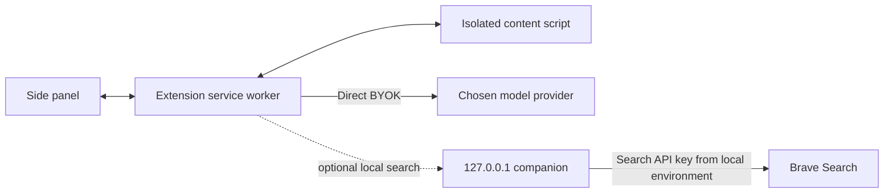

# Atlas architecture

## Trust boundaries

The Chrome extension owns browser permissions, observations, task state, and user approvals. In direct BYOK mode it calls a model provider directly; the local companion is optional and is never in the model-request path. The companion is a separate self-hosted process bound to `127.0.0.1:8080` and currently offers a health check and optional search integration.

The extension is the authority for browser actions. A model proposal must pass local schema validation and policy checks before execution. Page content is evidence, not trusted instructions. Consequential actions require an explicit user approval bound to the proposed action and current page state.

## Backend boundary

The Go companion is optional and self-hosted. It binds to IPv4 loopback only, requires a locally configured bearer token for non-health routes, places limits on request bodies and search parameters, and reads external search credentials only from its process environment. It does not implement model proxying, browser control, or persistence. No browser-stored BYOK credential may be sent to it.

## Task state

Core data contracts are shared from `packages/contracts`. The extension persists authoritative task state locally so MV3 worker restarts do not depend on in-memory state. Messages and stored records are validated at runtime; tool execution and outcome verification are separate steps.
